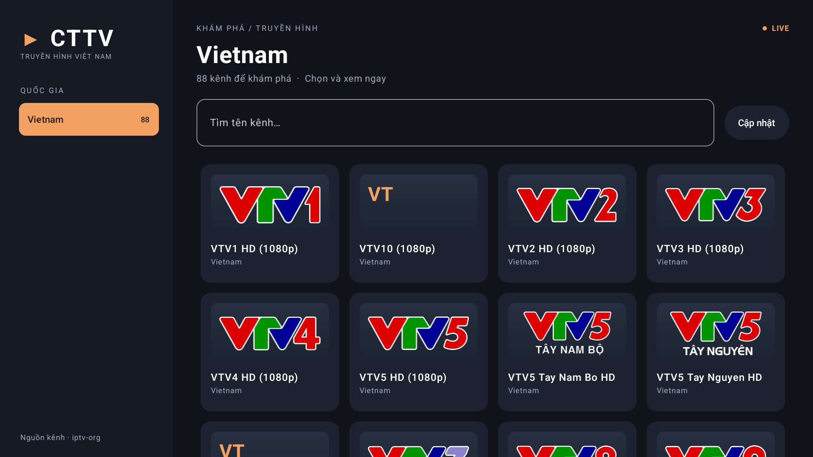
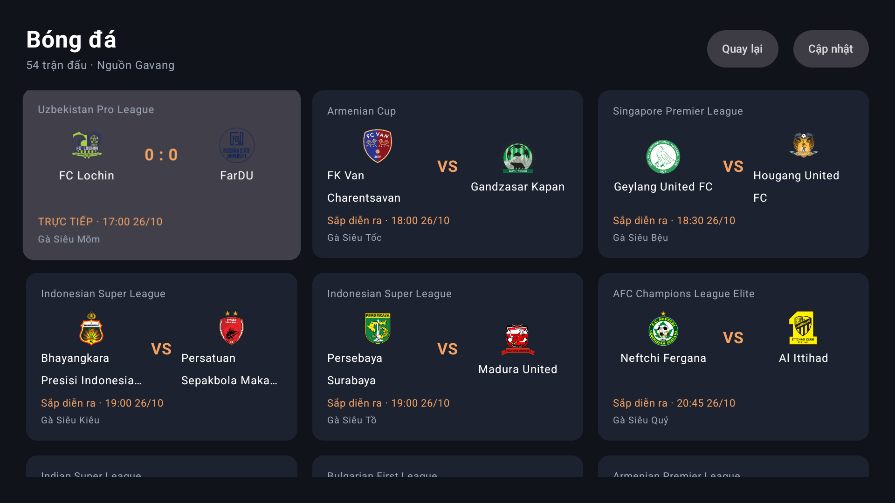

# CTTV

Ứng dụng IPTV Việt Nam cho Android TV, viết bằng Kotlin, Compose for TV và Media3/ExoPlayer.
Mở app, chọn Truyền hình để xem các kênh Việt Nam hoặc Bóng đá để chọn trận và BLV; không cần tài khoản hoặc backend.



## Chức năng

- Chỉ tải [playlist Việt Nam của iptv-org](https://iptv-org.github.io/iptv/countries/vn.m3u).
- Tìm tên kênh, hiển thị logo và xem toàn màn hình; các kênh có tên bắt đầu bằng VTV được xếp trước.
- Mở app có hai lựa chọn: **Truyền hình** và **Bóng đá**, mặc định focus Truyền hình.
- Chọn Truyền hình mới tải danh sách và tự focus vào Việt Nam; OK hoặc phím phải đưa focus vào danh sách kênh.
- Bóng đá tải toàn bộ danh sách trận từ Gavang, ưu tiên trận trực tiếp; hiển thị đội, giải, tỷ số và giờ Việt Nam.
- Chọn trận để tải BLV, chọn BLV để phát HLS. Những BLV chưa có nguồn HLS được ghi rõ, không dùng video mặc định thay cho trận.
- Back đi từ video bóng đá → danh sách BLV → danh sách trận → màn hình chọn mục, giữ focus tại lựa chọn vừa xem.
- Điều khiển bằng remote: phím hướng di chuyển, OK chọn, Back trở về.
- Quay lại danh sách ở vị trí và kênh vừa xem.
- Gom mục trùng ID; tự thử nguồn tiếp theo khi một nguồn bị lỗi.
- Giữ User-Agent/Referer/Origin được khai báo trong playlist để phát những kênh yêu cầu chúng.
- Lưu danh sách Việt Nam trong cache riêng, hiển thị ở lần mở sau và cập nhật qua mạng. Cache chỉ chứa danh sách, không chứa video.
- Giải phóng player khi app đi vào nền hoặc rời màn hình xem.
- Thông tin kênh tự ẩn sau 3 giây; bấm remote để hiện lại cùng thanh điều khiển.

## Thiết bị

- Android 6.0 / API 23 trở lên; mục tiêu chính là TV Android 11 / API 30.
- APK chứa các ABI `armeabi-v7a`, `arm64-v8a`, `x86_64`, gồm ARM 32-bit cho MiTV-ASTR0.
- Không yêu cầu Google Play Services hoặc Play Store. Có launcher thông thường lẫn TV launcher.
- Không yêu cầu màn hình cảm ứng. Điện thoại Android cũng cài được, giao diện hiện ưu tiên TV nằm ngang.

Khả năng cài đặt không đồng nghĩa mọi stream đều phát được: codec, chất lượng mạng,
nguồn ngừng hoạt động và giới hạn vùng của nhà phát sóng vẫn ảnh hưởng kết quả.
Phần lớn giao thức phát phổ biến HLS/DASH và các file HTTP/HTTPS được Media3 hỗ trợ.
Các nguồn RTMP/SRT/MMSH vẫn xuất hiện trong danh sách nhưng được ghi rõ là chưa hỗ trợ phát.
Phiên bản này chưa có iOS, EPG/lịch chương trình, ghi hình hoặc giải mã phần mềm bổ sung.
Danh sách theo vùng phát sóng Việt Nam trong playlist của iptv-org.

## Mở project

Mở thư mục này trong Android Studio và đợi Gradle Sync. Chọn JDK đi kèm Android Studio.
SDK dùng để build: API 36. Build Tools: 36.0.0. Các thư viện được Gradle tải tự động.

Để chạy local trên Mac:

1. Chọn **File → Open** và mở thư mục project `cttv`.
2. Mở **Tools → Device Manager**, khởi động `Pixel_9` hoặc `Pixel_10_Pro` đang có trên máy.
3. Chọn run configuration **app**, chọn máy ảo vừa mở rồi bấm **Run ▶**.
4. App dùng bố cục nằm ngang. Có thể dùng chuột để chọn kênh; để thử remote,
   mở **Extended Controls → Directional pad** của emulator.

Hai máy ảo Pixel kiểm tra được luồng sử dụng và phát video; vẫn cần kiểm tra riêng trên TV thật ở bước sau.

Build từ terminal trên máy Mac hiện tại:

```sh
export JAVA_HOME="/Applications/Android Studio.app/Contents/jbr/Contents/Home"
export PATH="$JAVA_HOME/bin:$PATH"

if [ -f .env ]; then
  set -a
  source .env
  set +a
fi

./gradlew :app:assembleDebug --no-daemon
```

Trên máy khác, đặt SDK trong `local.properties` (`sdk.dir=...`) hoặc dùng `ANDROID_HOME`.
Không commit `local.properties`. Gradle Wrapper đã đi kèm; không cần cài Gradle toàn máy.

APK: `app/build/outputs/apk/debug/app-debug.apk`.
Đây là bản debug đã ký để cài trực tiếp, chưa phải bản phát hành trên cửa hàng.
Muốn giữ khả năng nâng cấp cùng ứng dụng về sau, cần dùng cùng signing key.

## Build bằng GitHub Actions

Workflow [Android CI](.github/workflows/android.yml) tự chạy khi push lên `main` hoặc mở/cập nhật PR vào `main`.
Workflow dùng Java 21, Android SDK 36 và Gradle Wrapper của project; chạy unit tests và lint,
sau đó build APK debug khi các kiểm tra đều qua. Không cần cấu hình secrets.

Để chạy thủ công và tải APK:

1. Push code có workflow này lên nhánh `main` trên GitHub.
2. Vào **Actions → Android CI → Run workflow**, chọn nhánh rồi bấm **Run workflow**.
3. Mở lần chạy đã hoàn tất, xuống **Artifacts** và tải **app-debug.apk** để cài lên thiết bị.
4. Artifact **android-test-reports** chứa kết quả unit tests và báo cáo lint, kể cả khi kiểm tra thất bại.

Các artifact được giữ 14 ngày. Workflow này chưa chạy UI/player tests trên emulator;
những kiểm thử đó vẫn chạy riêng theo hướng dẫn bên dưới.

APK dùng debug key do runner tạo nên có thể khác chữ ký của bản local hoặc lần build trước.
Nếu cài đè báo `INSTALL_FAILED_UPDATE_INCOMPATIBLE`, cần gỡ bản cũ trước khi cài (cache app sẽ bị xóa).
Để cập nhật lâu dài mà không phải gỡ app, cần cấu hình signing key cố định.

## Cài lên TV qua ADB

Bật ADB/debug mạng trên TV và kết nối Mac cùng mạng. Thay `<IP_TV>` bằng địa chỉ TV:

```sh
adb connect <IP_TV>:5555
adb devices -l
adb -s <IP_TV>:5555 install -r app/build/outputs/apk/debug/app-debug.apk
adb -s <IP_TV>:5555 shell am start -n dev.cttv/.MainActivity
```

Nếu TV dùng cổng ADB khác, thay `5555` bằng cổng TV cung cấp.
Xác nhận hộp thoại cho phép debug trên TV nếu xuất hiện.

## Kiểm thử

Nạp `.env` nếu có và cấu hình JDK như phần build trước khi chạy:

```sh
./gradlew :app:testDebugUnitTest --tests 'dev.cttv.data.*' --tests 'dev.cttv.football.*' --no-daemon
./gradlew :app:lintDebug --no-daemon
```

Kiểm thử UI/player trên thiết bị hoặc máy ảo riêng dành cho kiểm thử:

```sh
ANDROID_SERIAL=<serial> ./gradlew :app:connectedDebugAndroidTest \
  -Pandroid.testInstrumentationRunnerArguments.class=dev.cttv.ui.CttvAppTest,dev.cttv.ui.CatalogScreenTest,dev.cttv.ui.FootballScreenTest,dev.cttv.ui.PlayerScreenTest \
  --no-daemon
```

Unit tests kiểm tra parser, header, URL hợp lệ, bộ lọc và cache khi lỗi mạng/dữ liệu.
UI tests kiểm tra màn hình chọn mục, remote, focus khi quay lại, bộ lọc, phát video, nguồn dự phòng và màn hình lỗi.
Kiểm thử bóng đá kiểm tra cấu hình API động, danh sách trận/BLV, chọn đúng HLS, header phát, lỗi nguồn và hủy tải khi Back.
Có kiểm thử đi từ Việt Nam đến danh sách kênh, phát video và quay lại chỉ bằng bốn phím hướng, OK và Back.
Video kiểm thử là mẫu hình/mẫu âm thanh được tạo bằng FFmpeg, chỉ nằm trong APK kiểm thử.

Máy ảo kiểm tra là Android thông thường với màn hình ngang, chưa thay thế kiểm tra trên Mi TV ARM 32-bit.

## Thêm hoặc thay nguồn bóng đá



`football/FootballSource.kt` định nghĩa hai thao tác: tải trận và tải BLV cho một trận.
Mỗi BLV trả về danh sách `Stream` riêng (URL và header); UI và player không đọc HTML/JSON của website.

`football/sources/GavangSource.kt` chứa toàn bộ địa chỉ và cách đọc dữ liệu của Gavang:

- Đọc cấu hình API động từ `https://gvabc.cc/websocket`, dự phòng bằng `https://gavang33.uk/config.json`, giống JavaScript của website.
- Gọi danh sách và chi tiết trận với `webType=gavang`, gộp BLV riêng từ danh sách khi chi tiết chưa có.
- Giữ HLS của đúng BLV, bao gồm server dự phòng; không dùng FLV hay `defaultLink` là video mặc định.
- Chỉ tải chi tiết khi chọn trận; không lưu URL phát xuống đĩa. Chọn Thử lại để lấy lại nguồn mới.

Để đổi website, tạo một file khác triển khai `FootballSource`, rồi thay nguồn mặc định trong constructor `FootballViewModel`.
Không cần sửa màn hình chọn trận, chọn BLV hoặc player. Nút Cập nhật tải lại danh sách; phiên bản này chưa đồng bộ tỷ số qua WebSocket.

## Nguồn

Truyền hình đọc danh sách URL công khai từ [iptv-org/iptv](https://github.com/iptv-org/iptv).
Bóng đá đọc API công khai mà [Gavang](https://gavang33.uk/) dùng cho website.
Video phát trực tiếp từ nhà cung cấp nguồn; dữ liệu có thể thay đổi độc lập với app.
Một số nguồn dùng HTTP nên app cho phép cleartext traffic để phát những nguồn này.
